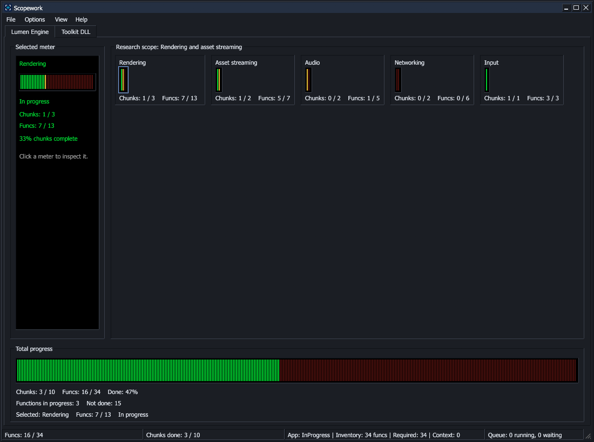
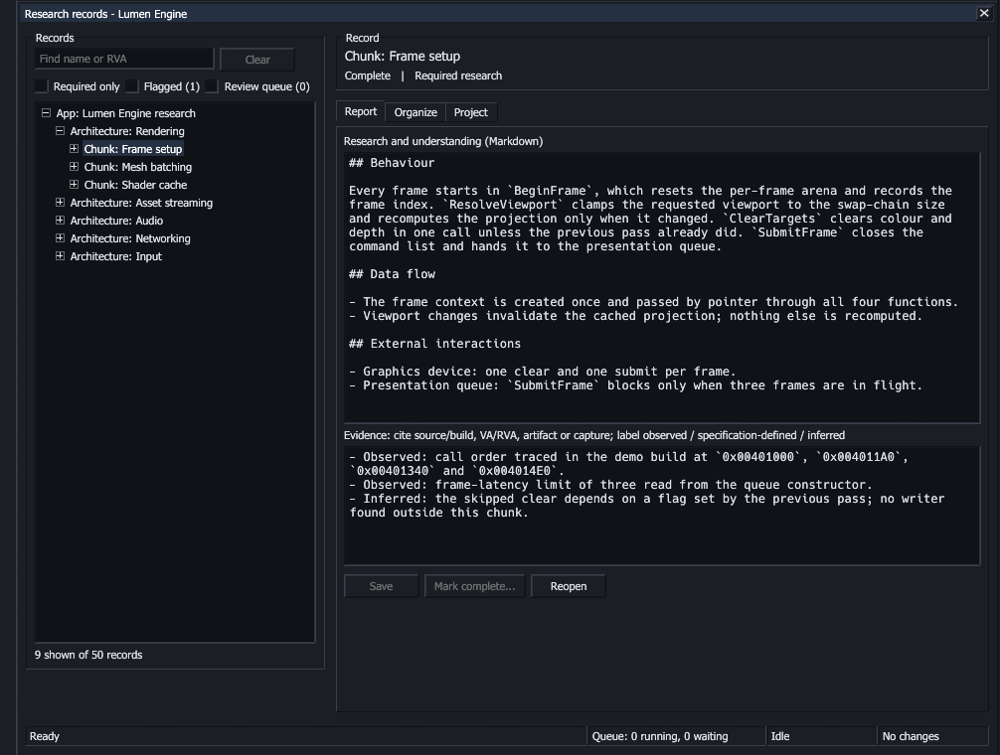

<p align="center">
  
</p>

<h1 align="center">Scopework</h1>
<p align="center"><strong>A local workbench for binary research, shared by people and AI agents.</strong></p>
<p align="center">
  <a href="https://github.com/isekaishy-jpg/ScopeWork/actions/workflows/windows.yml"></a>
  <a href="https://github.com/isekaishy-jpg/ScopeWork/releases"></a>
  <a href="LICENSE"></a>
  
</p>

<p align="center">
  <a href="docs/installation.md">Install</a> ·
  <a href="https://github.com/isekaishy-jpg/ScopeWork/releases">Releases</a> ·
  <a href="docs/research-model.md">Research model</a> ·
  <a href="docs/cli.md">Agent CLI</a> ·
  <a href="CONTRIBUTING.md">Contributing</a>
</p>



Reverse engineering a large binary produces a lot of understanding, spread over thousands of functions. Scopework gives that understanding a structure:
- every function, chunk and subsystem gets one canonical report;
- completion follows explicit rules;
- a dashboard shows how far the research has come.

The same records are available to AI agents through a JSON command line, so several agents and people can work on one project at once without stepping on each other.

*The screenshots show a fictional demo project, Lumen Engine.*

## How research is organised

```text
App               what the project set out to understand
└─ Architecture   a subsystem, such as Rendering or Audio
   └─ Chunk       a group of related functions
      └─ Function one routine at one address, with its evidence
```

- **Fixed scopes.** A function report explains that function: its behaviour, inputs, outputs, side effects and connections, with evidence. A chunk synthesises its completed functions, an architecture its chunks, and the app its architectures.
- **Completion is earned, never inherited.** Completed children make a parent ready for synthesis; they do not complete it. Every parent needs its own report, and completing a record is a deliberate, token-checked attestation.
- **Changes reopen what they affect.** Prerequisites between functions are explicit. When a report or prerequisite changes, the completed records that relied on it go back to In Progress and into a review queue.
- **Evidence is classified.** Claims are marked as observed, specification-defined or inferred. A function's captures and exports live in its own `data/` folder, beside its report.



## Features

- **Progress at a glance.** Each project has a tab, each architecture a meter, and each chunk a segment of it. Totals show function and chunk counts and the project's research scope. Related projects can share one tab as a group, with a menu to switch between them.
- **Research records window.** Search the whole binary by name or address; write reports and evidence; flag records for review; organise the hierarchy; mark work complete when its requirements are met.
- **Whole-binary inventories.** Enrol tens of thousands of functions with resumable batch imports and keep context-only code in the inventory without making it required work.
- **Implementation tracker.** Record a recreation alongside the research: a free-form tree of its crates, modules or files, the researched functions placed where they are implemented, implementation-only items and their completion. The dashboard switches between **Research** and **Implementation** for each project.
- **Quarantine.** Take a chunk or function out of research, at the human's request or after a safety stop. It counts as complete, never shows up as open work, and is sealed against structural changes unless the human directs them.
- **Renames that follow through.** Renaming a record rewrites its citations in every report, without reopening the completed work they appear in.
- **Built for several agents at once:**
  - A coordinator answers reads without waiting for writes, and merges queued saves into one commit.
  - Every read says which writes are pending on the records it returned.
  - The dashboard footer counts queued and running writes.
  - Agents can claim parts of the tree, and a review queue lists records that other people's changes reopened.
- **Tool coordination.** Analysis tools can take leases on shared resources such as an annotation database. Requests of the same kind are collected into one run. Changes made outside a lease are recorded as drift.
- **Recoverable and readable history.** Every change is a journaled transaction that survives crashes. `research history show` and the **Project history** window list what changed, when and why, filtered by record, address, kind or day.
- **Your files, on your machine.** A research home is a plain folder of Markdown reports and JSON. Projects are isolated from each other by exact binary identity, and uninstalling never touches your research.

## Install

Download the Windows x64 installer from [Releases](https://github.com/isekaishy-jpg/ScopeWork/releases), or [build it yourself](docs/building.md). The setup wizard asks for the application folder, the research home, PATH access and a desktop shortcut.

Then open Scopework from Start, choose **File > New project...**, and use **View > Research records** to build the hierarchy and write reports.

## Use it from an agent or script

With PATH access enabled, every command answers in JSON:

```powershell
research project create lumen --name "Lumen Engine" --binary "lumen.exe 2.4.1; SHA-256 ..."
research node create lumen --parent 0 --name "Rendering"
research node show lumen 3                      # report, evidence, tokens and status
research node save lumen 3 --body-file body.md --evidence-file evidence.md --expect <token>
research node complete lumen 3 --expect <completion_token> --reviewed
research status lumen --summary
research --version                              # Scopework 0.14.0a (Build <number>)
```

Tokens make every write conditional on what the writer last read, so concurrent agents cannot silently overwrite each other. The [CLI guide](docs/cli.md) covers batches, prerequisites, claims, the review queue, quarantine, history, dashboard groups, the implementation tracker, the coordinator and tool leases.

## Status

Scopework is **alpha** software (0.14.0a) under active development. Its formats and interfaces may still change between versions, and every change is recorded in the [changelog](CHANGELOG.md). The installers are not code-signed. Completion records are attestations of understanding made by people or agents, not an automatic judgement of research quality.

## Documentation

| Guide | What it covers |
| --- | --- |
| [Installation](docs/installation.md) | Setup choices, research locations, upgrades and uninstall |
| [Research model](docs/research-model.md) | The hierarchy, evidence, completion and prerequisites |
| [Agent CLI](docs/cli.md) | Every command, batches, concurrency, the coordinator and tool leases |
| [Build guide](docs/building.md) | Building from source, packaging, versions and build numbers |
| [Changelog](CHANGELOG.md) and [release notes](docs/releases/0.14.0a.md) | What changed in each version |
| [Coordinator design](docs/proposal-coordinator.md) | How reads, queued writes and tool work are coordinated, with measurements |

## Contributing

Bug reports and focused improvements are welcome; see [CONTRIBUTING.md](CONTRIBUTING.md). Please keep research datasets, captures and proprietary binaries out of the repository.

## License

Scopework is released under the [MIT License](LICENSE). Third-party dependencies keep their own licenses.
